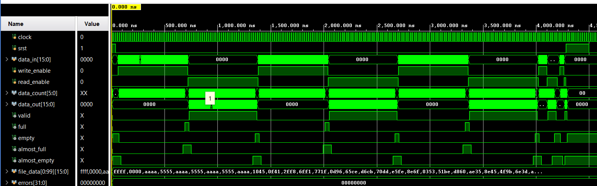
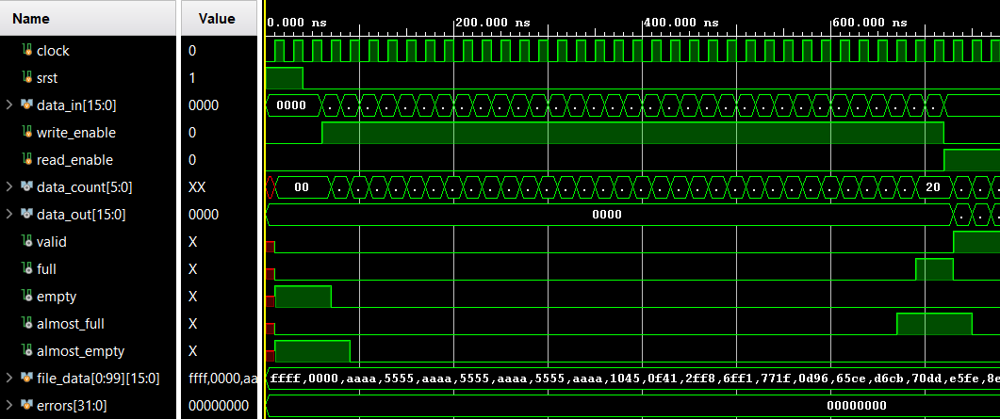
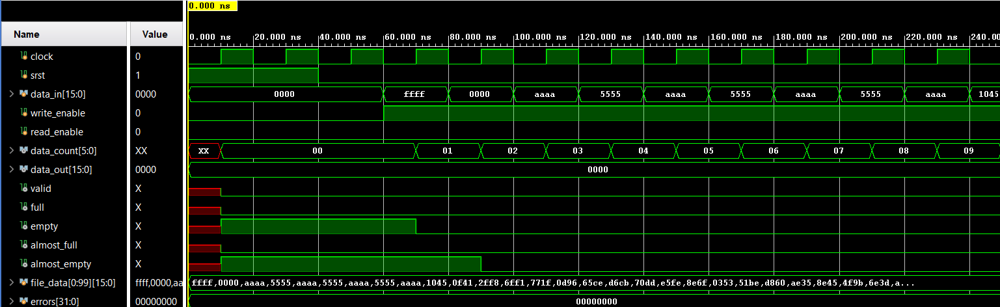
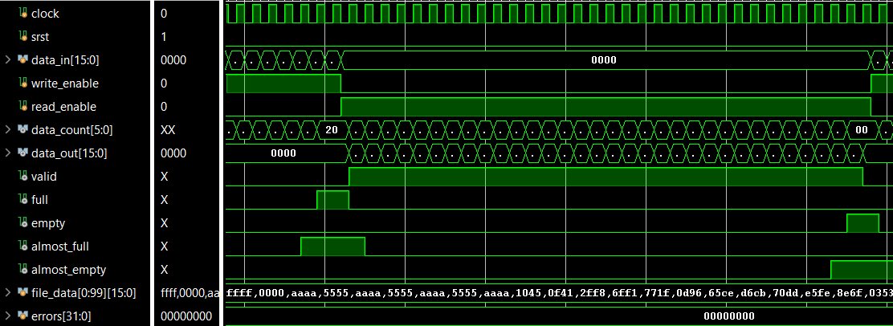
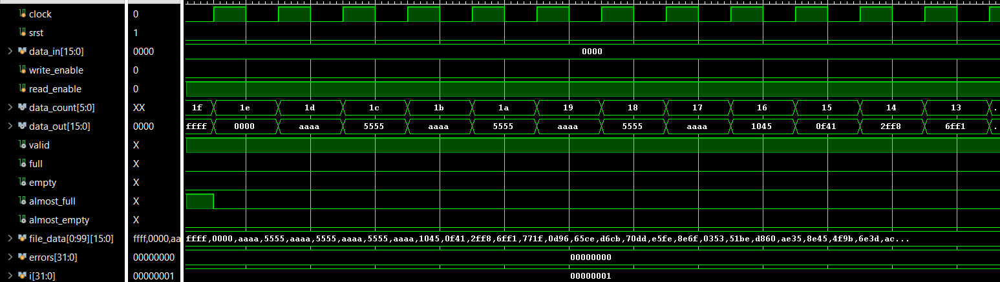
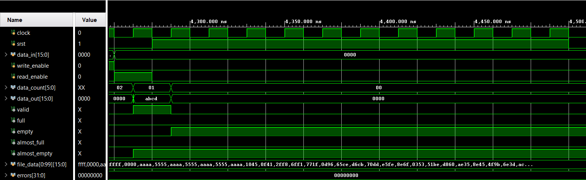

# ECE_520_Lab3

## Overview

The lab consists of designing and verifying a parameterized First-In, First-Out (FIFO) memory system using Block RAM (BRAM) in Vivado. FIFO is a memory structure where the first piece of data stored into memory is the first one to be read out.

## Design Summary

The design consist of using the same clock for both read and write operations. It allows for configurable parameters such as data width, memory depth, status thresholds, and read latency. The default parameters for the FIFO is:
- 16 bits width 
- 32 words depth
- 1 for almost empty 
- 31 for almost full
- 1 for read latency
The number of pipeline registers for read latency is a minimum of 1 and a maximum of 8.

The design uses read and write pointers to manage data stored in BRAM. It implement FIFO control logic that maintains the correct order of stored data and prevents overflow and underflow. It also includes status flags to indicate when the FIFO is empty, full, almost empty, or almost full. There is also additional status flags such as valid and data count. The valid flag highlights that a read operation has been requested while data count is the number of words available in the FIFO.

The reset feature was designed to not clear every BRAM memory location but to reset only the FIFO's control logic, status flags, and any other observable outputs to their initial states

Additionally, Python was used to generate simulation input data and was stored in a text file. The python script generated 100 words.

## Verification

The FIFO design was verified using a self-verifying testbench. It used a 50 MHz clock and an active high reset in the simulation. The testbench read the input text file to showcase the write and read operations of the FIFO. The simulation tested different data patterns such as all 1s and alternating bit patterns such as 0xAAAA or 0x5555. The testbench also covered writing to every memory location and reading every memory location back. The reset function was also tested and verified. The testbench verified the status flags, read_enable, and write_enable signals. The FIFO was evaluated by comparing the expected outputs with the actual outputs by examining the simulation waveforms to confirm that it worked as intended.

The FIFO can only read/write 32 words so it required 4 operations of read/write as seen by the screenshot bellow. The waveform showed that the status flags are working as intended. It asserts the empty and almost empty status flag at the start of the write operation and end of the read operation. The almost empty is asserted slightly longer than empty. It asserts almost full flag first then the full flag at the end of the write operation and start of the read operation. The testbench also reveals that write_enable and read_enable is in sync with the data_in and data_out. The valid flag is correctly asserted during read operation. There was no errors in the design as seen by the error waveform.

The screenshots bellow zooms in the write operation. It shows that the input data is correctly written in data_in. The FIFO stores the input data in the order of the input data text file. It also displays the different input data patterns such as 0xFFFF, 0x0000, 0xAAAA, and 0x5555.

The screenshots bellow zooms in the read operation. It shows that the values are read and retrieved in the same order it was stored.

The screenshot bellow highlights that the reset is working as intended. The status flags and observable outputs are 0.

## Known Issues or Limitations

No known issues or limitations.

## References

None